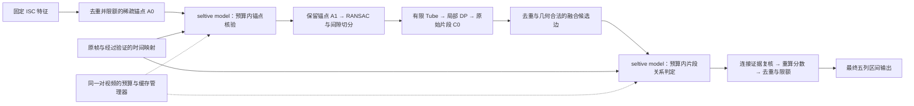

# FastVCL 第四轮审查与执行方案：JEV 锚点过滤与片段融合

日期：2026-10-19。状态：**执行设计已明确；方法修改、模型接入和真实实验尚未执行。**

本轮依据用户最新要求，把 JEV 用于两个具体位置：**轨迹拟合前过滤可疑锚点，局部对齐后决定相邻片段是否融合。** 此设计取代第二轮方案和旧 `selective_model_spec.md` 中“仅候选后置核验”的限定。保留用户指定名称 `seltive model`，在论文中为它补充清楚的英文功能说明。当前任务交付审查和方案，不自动启动 DSH 或实验任务。

## 1. 审查结论与优先级

当前稿件已改善数学和评估叙述，但仍没有可填入主表的冻结实验。新一轮应转向“实现闭环和最小证据”，而不是继续扩写研究计划。独立审查记录、重跑结果和源码快照见 [round4_review.md](evidence/round4_review.md)。

| 优先级 | 现稿/原型问题 | 本轮处理 |
|---|---|---|
| P0 | Method 和框架图只画候选后置核验，与用户要求的两处接入不符 | 重写两处调用、统一预算、失败回退和算法伪代码 |
| P0 | 原型已有锚点核验管线，但无真实后端；默认 `NOT_COPY` 硬删、`COPY` 权重乘 1.25 | 不直接打开旧开关；先 shadow，再用独立开发数据确定动作阈值 |
| P0 | 旧 `merge_overlapping_segments` 按区间条件取并集并取最大分数，不判断复制连续性 | 新建带几何约束、视觉判定和连接证据的融合模块 |
| P0 | 零下界 DP、边界 margin、独立支持计数仍有论文/代码分歧 | 保留 legacy，增加明确的新变体；先锁定 core，再研究 JEV |
| P0 | 原帧、特征索引映射、模型和算力没有本轮可运行证据 | 作为资产门槛；缺失时交付可测试接口和阻塞清单，不伪造模型结果 |
| P1 | Related Work 和 BibTeX 缺 Visual Jev、VideoJev | 增加正确引用，区分现有能力与本项目提出的复制任务迁移 |
| P1 | E6 的“固定候选池”设计不能单独评价前置过滤 | 拆为锚点实验、融合实验、完整管线实验，各自固定正确的上游输入 |
| P1 | 没有真实负例开发集；现有 validation 全为正视频对 | 单独建立并审计开发负例，冻结后才用 test 报 FAR |
| P1 | 标题强调 Training-Free，新增分支使用经过训练的外部模型 | 建议改为强调预算和选择性决策的标题；说明本任务是否进行了适配 |

建议工作标题：**FastVCL: Budgeted Visual Decisions for Sparse-to-Tube Video Copy Localization**。这只是写作建议；`Fast` 仍不代表已经证明加速。

## 2. JEV 身份与近期工作核查

这里沿用项目历史中的“视觉复制核验”含义，不把 JEV 自动解释为 V-JEPA/JEPA。核查日期为 2026-10-19。

| 对象 | 一手材料确认的能力 | 本项目用法与边界 |
|---|---|---|
| TypeSafe Jev | 结构化 state 和类型化决策；当前 State 文档明确音频、视频尚不支持 | 可提供决策接口思路；不把它写成原生视频复制判别器。本文也不沿用旧文档对图片能力的绝对断言 |
| Visual Jev，2026-09-22 | 同一图像/公共上下文上的独立问题，共享前缀，候选概率读出；作者发布基于 Qwen3-VL-4B 的 answer-supervised LoRA | 适合以真实帧证据板验证锚点/边界；单图任务向双视频复制迁移是我们的待验证设计 |
| VideoJev，2026-10-13 | 将视频时序定位和多选问答实现为候选评分；提供 4B/35B-A3B 模型及 Cached/Joint 推理 | 优先调查 4B 对局部时序证据的效果；官方视频任务不等于支持双视频同源复制判别 |
| 本地 `VisualJEV` | 帧定位、通用 VLM client、JSON 解析、预算和回退的工程接口 | 不是上述模型的已完成复现；不能用类名当作模型身份 |

来源：[TypeSafe State](https://docs.typesafe.ai/concepts/state)、[Visual Jev 论文](https://arxiv.org/abs/2609.25845)、[Visual Jev 作者代码](https://github.com/guanxuyu-sv/Visual-Jev)、[VideoJev 论文](https://arxiv.org/abs/2610.18615)、[VideoJev 作者代码](https://github.com/MCG-NJU/VideoJev)。

**后端选择的执行决定：** 先以 Visual Jev-4B 的真实帧证据板实现最小可运行版本；在同一小试集上将 VideoJev-4B 作为时序后端对照。按复制判定质量、误伤和完整成本选择一个后端冻结，供两个阶段共用。首轮不同时常驻两套大模型，不从零训练大模型，不引入新的学习路由器。若只有一个后端具备资源，记录缺失对照，先完成该后端的小试，不能声称优于未运行的模型。

**可借鉴的是候选直接评分、明确弃权、重复上下文复用。** 已发表的通用准确率、加速倍数不能移植为 FastVCL 结果。Visual Jev 论文并未证明额外 evidence-sufficiency head 普遍有益；VideoJev 论文也明确候选概率存在过度自信。因此默认不新增“证据充分性头”，`p=0.95` 不被解释为复制正确率 95%。[Visual Jev 全文](https://arxiv.org/html/2609.25845v1)、[VideoJev 全文](https://arxiv.org/html/2610.18615v1)。

## 3. 新方法主线与三个可证伪假设

- **H4-A：过滤价值。** 选择性核验减少错误锚点引起的伪轨迹，在预声明召回损失范围内减少误报或下游计算。减少锚点数本身不是成功。
- **H4-F：融合价值。** 视觉关系判定加连接检查，能修复真实复制的过度切分，同时优于纯几何融合，避免跨真实非复制间隙或不同复制位置误合并。
- **H4-B：预算价值。** 两阶段在完整实测成本下，比同预算随机选择、便宜规则及普通 VLM 判定获得更好的质量—成本折中。

H1–H3 的 core 覆盖、边界、系统成本实验继续保留。JEV 不能找回从未生成的锚点或片段；过滤也可能降低召回，融合也可能抹去真实边界，均需计量。

## 4. 锚点过滤的具体规则

### 4.1 接入位置与选择

1. 保存 `A0`：完成原始坐标去重和原 core cap 后的全部锚点。所有选择策略从同一 `A0` 出发；不在 JEV 前用额外规则偷偷删掉困难样本，也不补回 cap 丢掉的锚点。
2. 计算便宜信号：双向 Top-K margin、局部几何残差、同一 A/B 时刻的竞争匹配、时间覆盖和独立支持。若计算几何预拟合，把其成本记入总时间。
3. 默认无训练选择器：按两轴时间邻域分组，组间轮转以避免重复纹理簇耗尽预算；这里只去重选择配额，不删除原锚点。起始组内优先分数为 `0.5 × rank_small_margin + 0.5 × rank_large_residual`，两项均为 A0 内归一化秩，分数越大越优先；margin 取双向 margin 较小者，缺几何支持时 residual 秩取 0.5，单元素池的秩取 0.5。组宽初设为各轴最细采样 stride 的两倍，按原始 `(i,j)` 落入固定网格分组。稳定 tie 使用 `(i,j)`，随机基线固定种子。该排序与组宽作为明确起始配置，仅允许在 dev_design 调整并留痕。
4. 一个受询锚点产生一个判定；相邻锚点可以共享真实证据板，但不能把一个锚点的 `NOT_COPY` 自动传播到未询问锚点。

新 selector 必须是 **selection-only**：旧 `_route` 可能在 `_verify` 前将锚点放入 `rejected`，而后端不可用时只恢复 `verify` 部分；因此不能仅替换模型 client 就声称“失败全部保留”。新路径从 A0 全量出发，不继承旧 router 的预删除，也不启用额外 disagreement 降权；以逐锚点测试证明未选中/失败的恒等行为。

### 4.2 视觉输入与输出

起始输入规格：每侧中心及前后两个邻近采样位置，共至多三对真实帧；从 `feature_index → timestamp/frame` 映射取帧。若存在局部斜率，用它给出邻域配对；不存在时明确标注两侧各自的时间点，不伪造对齐。采样偏移、图像分辨率、裁剪和缺帧策略写入 manifest，开发集选定后冻结。

Visual Jev 路线使用带 A/B、时间和格子编号的证据板；由真实帧拼接得到，属于本项目的输入适配。VideoJev 路线先验证其 API 能否接收所需配对证据；如采用并排同步片段或拼接视频，同样标为新适配，记录时间映射，不称为官方双视频接口。

主问题仅判断：**是否来自同一段底层拍摄素材，允许裁剪、变速、叠字、重编码等编辑；主题、人物或动作相似不足以证明复制。** 选项为 `COPY / NOT_COPY / UNCERTAIN`。使用候选读出时记录原始 logits/分数、选项顺序和归一化方式；普通 JSON 生成只作为独立对照。固定英文问题模板，不要求模型生成理由来参与自动决策。

### 4.3 动作与保护

开发前先运行 `shadow`：只写判定日志，输出与 core 完全相同。通过门槛后，设 `p_N` 为 `NOT_COPY` 候选分数，提出：

\[
D(a)=\mathbf{1}[a\text{ 被选择且成功核验}]\,
\mathbf{1}[p_N\ge\tau_A]\,
\mathbf{1}[p_N-\max(p_C,p_U)\ge\delta_A].
\]

`D(a)=1` 才允许从 `A0` 移除锚点。`COPY`、`UNCERTAIN`、未选中、超预算和失败均保持原锚点及原权重；不默认沿用旧 `COPY ×1.25`。过滤完成后重拟合轨迹和重验双轴独立支持，记录 `A0 → A1 → tracks → tubes` 的变化。

拟用开发网格：`tau_A ∈ {0.90,0.95,0.98}`、`delta_A ∈ {0.15,0.30}`。这些是待测操作阈值，不是已校准概率。没有合格阈值时保留 shadow；软降权和强制最小支持回退仅作为单独消融，不能隐式混入主方法。

核验关键指标：人工核查锚点误删率、短片段候选覆盖变化、最终 Recall/F1/FAR、轨迹数、Tube/DP 工作量和完整时间。VCSL 区间框只能提供区间内支持代理标签，不能当作真实逐帧锚点 GT。

## 5. 片段融合的具体规则

此处“融合”指决定多个定位碎片是否属于一段连续复制，并重新估计区间；不是把两个模型的标量置信度加权，也不是简单做 NMS。

### 5.1 构造可融合边

在 JEV 锚点过滤、RANSAC、DP 和片段抽取完成后，保存带 `track_id`、匹配节点、独立支持和原分数的 `C0`。先去除高 min-axis-IoU 的近重复预测，再构造片段对 `(c_u,c_v)`：

- A、B 两轴上的时间顺序一致；两轴间隙均在开发集冻结的上限内，保留原始 gap 和归一化 gap。
- 局部斜率兼容，两个时间映射在边界附近的预测差在残差容限内。比较映射预测值，不能只比较斜率或原始截距。
- 同一 A 区间映到不同 B 位置的多次复制不进入融合队列；无几何桥接条件的远距离候选也不进入。
- 使用确定性邻近候选生成和每片段邻居上限，记录候选边总数及截断数，避免无上限全配对。

默认按短间隙、映射一致性和边界证据排序；随机策略从相同合法边池抽取。不要把“同一主题”“同一人物”用作候选边条件。

### 5.2 判定与重建

输入必须包含两个碎片的内部对应帧、两侧邻接边界，以及间隙内部的可取得证据。不能只让模型看到两个端点就推断整个空隙都是复制。共享模型返回 `MERGE / KEEP_SEPARATE / UNCERTAIN`，问题明确问“是否属于同一连续复制对应，能否覆盖连接区间”。

设 `G(u,v)` 为几何合法性，`B(u,v)` 为连接证据检查，提出：

\[
M(u,v)=G(u,v)\land B(u,v)\land[p_M\ge\tau_F]
\land[p_M-\max(p_S,p_U)\ge\delta_F].
\]

只有成功且满足 `M=1` 才执行融合。`KEEP_SEPARATE / UNCERTAIN / ERROR / 超预算` 都保留原有片段，不能将 `KEEP_SEPARATE` 解释为删除复制。

`B(u,v)` 的初版操作定义：沿拟议连接轨迹计算有限区域 ISC 证据，检查有效覆盖和最长连续低分间隙；必要时在合并后的有限 Tube 重跑对齐，要求一条合法连接路径同时接触两个原片段并通过既定 gap/支持条件。连续性无法验证时保持分离。连接区域上限与新增 DP 开销也要冻结和统计；不靠放大 Tube 绕过门槛。

几何容限与连接证据阈值在训练来源的开发集确定；视觉操作阈值先使用与锚点阶段相同的小网格，但分别选择。重建端点由支持路径产生；对实际保留节点/锚点去重后重新计算 core 评分。初版不把 JEV 概率乘入 `q`，也不使用旧实现的 `max(q_u,q_v)` 作为新片段分数。

### 5.3 非传递性与顺序

`u-v` 和 `v-w` 都可融合，不代表三者可无条件并成一个大区间。按稳定优先级逐条处理，接受一次就重验当前集合相对全部原始成员的时间映射、完整连接域及支持；冲突或证据不足停止扩张。每对视频最多执行冻结轮数，默认一轮、不重用已消费成员；多轮只能作为单独配置。最后再执行 min-axis-IoU 去重和输出 cap。

必须覆盖：同源短缺口、长真实非复制间隙、相似场景不同素材、同一 A 对多个 B、双轴顺序冲突、速度变化、一个局部判定正确但传递合并错误、缺帧/预算耗尽。报告正确融合、错误桥接、漏融合、boundary MAE、共同 GT 集上的 MAE 以及全量 Recall/F1；仅减少输出片段数不算收益。

## 6. 统一预算、缓存和失败契约

第一版预声明每视频对判定预算 `K ∈ {0,4,8,12}`；默认操作点 `K=12`，最多 8 个锚点问题、4 个融合问题。这是小试配置，不是最优值。锚点阶段剩余额度允许单向移交融合，融合额度不提前借给锚点；所有策略使用同一规则。预算耗尽时保持原证据。

一般分配为 `K_A=floor(2K/3)`、`K_F=K-K_A`。两个任务共用判定记录格式：`pair_id, stage, item_id, anchor_or_segment_ids, evidence_hash, model_revision, prompt_hash, options, raw_scores, normalized_scores, decision, action, status, cache_hit, budget_before/after, timings`。使用错误选项、NaN/Inf 分数、错误 item_id 或损坏记录都视为失败，不进入动作阈值判断。

**问题数不是调用数。** 每次 batch 中的问题数、每个问题使用的原帧数、重复/唯一帧数、处理后视觉 token 数、输入大小、前向次数、视觉编码次数、缓存命中、峰值显存和耗时分别记录。按同一冻结的输入上限比较选择器，另外给出实测成本匹配结果；不能只靠等 12 个问题声称不同输入后端计算等价。

两个阶段共用一个 budget manager，禁止在融合阶段再次 `begin_pair` 清空额度。样本/问题预算包含缓存判定，物理执行预算单独记录；warm cache 不应让某策略获得更多决策。异常重试最多一次且计成本；正式策略预先声明重试预算，不能失败后无限补足成功次数。

仅当帧集合、布局、分辨率、公共提示、token 前缀和模型版本实际相同，才尝试共享 visual/KV 前缀；记录共享比例。两个阶段是先后依赖的，不能声称在一次前向中完成；不同片段也不能假称同一个共享前缀。先确保独立/批处理/共享路径的决策差异在可解释范围内，再比较耗时。

缓存键至少包含视频和帧内容哈希、时间映射哈希、问题类型、候选坐标、布局/预处理、选项顺序、prompt、checkpoint/adapter/readout 版本。失败不得缓存为 `NOT_COPY` 或 `MERGE`。

计时同时保留 `T_core_localize` 与 `T_augmented_end_to_end`；后者含原帧读取/解码、证据组织、几何预拟合、传输、模型、重试、桥接 DP、评分融合和最终输出。冷缓存与热缓存、首次模型初始化和稳态分开报告。主张加速必须比较完整边界，不能拿 JEV 路由时间替代模型时间。

## 7. 数据与最小验证集

1. 从训练来源视频划分 `dev_design / dev_calibration / dev_audit`，按共享视频/来源连通分量分组；审计与官方 validation/test 的视频交叉。无法隔离时报告重叠，不能宣称视频独立泛化。开发负例不得来自最终 test。
2. 第一批目标为约 200 个真实开发视频对，覆盖短复制、强编辑、重复镜头、语义相似非复制及多段复制。另整理不少于 300 个锚点判断和 150 个融合边判断作为可行性小试；数量不足时原样报告，不以合成样本补成“真实集”。
3. 锚点/融合动作标签需人工核查或可追溯的真实变换真值；记录样本、证据、来源、标注规则与分歧。模型自标或“落入 GT 矩形”只能当弱标签代理。缺可靠标签时继续做 core 和接口，不启用未经验证的硬动作。
4. 小试集采用模型质量和坏例诊断，不用于宣称 1% 风险已被证明。扩大到独立 audit 集后才评估预注册门槛；按视频分组估计不确定性，数据不足即标记证据不足。
5. 全量官方 validation 为正视频对，只选择正式输出阈值并报告 selection bias；它不能校准负对 FAR。冻结全部模型、prompt、动作阈值、预算、方法配置和预测评分方式后，执行预声明 test campaign。

建议工程验收目标：锚点动作的真实复制误删率上限 1%，融合动作的错误融合率上限 1%，最终 Recall 相对 core 下降不超过 **0.5 个百分点**。这些是待冻结的项目目标，不是理论保证或已达结果；需连同置信区间及样本量判断，不能只凭点估计或零错误通过。若数据不足或无可行阈值，动作继续 shadow，汇报有证据支持的较小结论。

## 8. 实验矩阵：区分模型、位置、选择和执行收益

E0–E5 按旧方案继续；E6 从本轮起拆分如下。**实验编号以论文工作区为准，邻近 FastVCL 历史任务书的 E 编号不同。**

| 实验 | 固定项 | 对照/干预 | 必报结果 |
|---|---|---|---|
| E6-A 锚点过滤 | 同一序列化 `A0`、同一 core 配置和模型 | 无动作、随机选择、margin/几何规则、时间分散选择；同输入上限 | 动作错误、后续候选覆盖、全量 P/R/F1/FAR、下游/总成本 |
| E6-F 片段融合 | 无 JEV 过滤的同一 `C0` 和合法边池 | 不融合、几何+连接证据、随机 JEV、选择性 JEV | 错误桥接、正确融合、Recall、共同 GT 的 MAE、成本 |
| E6-J 两阶段组合 | 同一输入视频对、冻结模型及 core | core、仅 A、仅 F、A+F 四格 | 全量质量、共同/丢失/新增匹配、完整耗时、两阶段预算使用 |
| E6-S 共享执行 | 同一权重、问题、布局、读出 | 独立串行、普通 batch、共享前缀 batch | 决策一致性、预填充/后缀时间、峰值内存、真实共享率 |
| E6-R 读出与权重 | 同一证据池，逐项控制 | 同一 backbone 的 JSON/候选读出；原始 backbone/作者适配权重 | 分离结构化读出、预训练/后训练和调用策略的贡献 |
| E6-V 视觉必要性 | 同一问题和选项 | 真图、遮蔽图、错配图、选项排列；VideoJev 时序/静态对照 | 识别语言先验、证据泄漏和选项偏置 |

E6-A 的下游轨迹与片段池必然可能改变，不能强制固定为 core 候选后再宣称测到了过滤效果。E6-F 才能固定片段池隔离融合效应；E6-J 必须完整重跑各分支，不可把两个独立小试的增益相加。

预算比较分两种图：四格位置实验明确标出每阶段资源；相同**总预算**实验允许单阶段使用全额度，再与拆分预算的 A+F 比较。禁止把 A 的 8 次加 F 的 4 次与单阶段 4 次直接归因为“两阶段更好”。

保留一项廉价视觉/局部对应核验对照（使用同样原帧与可复现实现），排除“只因多看了像素”带来的增益；具体实现先锁定再运行。资源紧张时优先 E6-A/F/J、随机和几何对照，后端规模、软降权、训练路由均延后。

模型升级、输入额外、训练适配与执行优化必须分别记账。主文同时保留同 ISC 输入的 core 表和含额外视觉输入的系统表；同后端、同帧输入、同预算的 E6 才用于归因选择策略。

## 9. 执行工作包与验收

以下路径中标注“新增”的是实施目标，目前不存在；不能把表中任务当作已完成。

| 工作包 | 操作与代码入口 | 交付物 | 通过条件 |
|---|---|---|---|
| W0：冻结起点和资产，约半天 | 复核 HEAD、工作树、现有配置、原视频/帧、映射、模型/GPU；记录两套后端来源 | `round4_asset_manifest.json`（新增）、样本/配置哈希、可执行与缺失项 | 不猜帧映射；现有用户修改保留；缺资产分项写明 |
| W1：core 语义闭环，约 1–2 天 | `tube.py / segments.py / pipeline.py`：新增零下界 DP、distinct 双区间支持、显式零 margin 与 A 范围；legacy 可复现；实现 Simple Sparse-to-Band 共用组件 | variant 配置、A1–A12 测试、真实预测文件的评分器一致性 | score/path/endpoints 对小网格 oracle 一致；关 JEV 时不会引入路由/模型开销 |
| W2：统一 JEV 接口，约 1–2 天 | 复用 `visual_jev.py` 的帧/失败框架；新增 `jev_backend.py / decision_budget.py`，适配候选概率读出 | model/frame/prompt manifest、结构化判定日志、独立/共享执行检查 | 能运行固定真实样本；mock 仅标接口测试；两个阶段不重置预算 |
| W3：锚点模式，约 1 天 | `_verify` 前后接入新 selector 与动作策略；旧 `VerdictPolicy` 不自动继承；`shadow/filter` 显式配置 | `A0/A1`、删除原因、真实 anchor audit、E6-A 小试 | shadow 与 core 输出逐项一致；失败/超预算回退；误删和覆盖损失有账目 |
| W4：片段模式，约 1–2 天 | 新增 `segment_fusion.py`，进入跨轨迹最终 cap 前；保存匹配节点、几何边、桥接复核 | `C0/edges/fusion_actions/final`、E6-F 小试 | 不同 B 复制保留；长缺口不桥接；融合重算分数；非传递反例通过 |
| W5：完整开发验证，约 2 天 | E6-J 与同预算随机/规则；冻结 audit 规则；同机计时 | `round4_pilot_report.md`、全量小试 metrics、质量—成本图 | 决策、候选、最终输出和成本闭环；不能只报被选子集正确率 |
| W6：正式证据和成稿 | 依据门槛决定扩展；完成核心及系统正式对比；更新所有论文入口 | 冻结协议、完整预测/status/指标/耗时、主文/补充/图表 | 完整零 ERROR/SKIPPED 的正式结果；没有数据的项保持 PENDING |

W1 和 W0/W2 可以作为独立工作流交错推进，但 W3 的正式收益必须建立在冻结 core 上；W4 的接口不依赖锚点收益先通过。时间为工作量估计，依赖资产和机器，不能代替实验完成条件。

实现必须保留两个命名配置：`FastVCL-core` 与 `FastVCL-JEV`。原代码的 layer1 配置可能强制关闭 JEV；通过显式新增实验 stage/config 接入，不悄悄修改历史 `isc_only.yaml` 的含义。TransVCL 参考代码、数据和 GT 保持只读；运行使用新目录。后续执行所需跨仓库写入以实际执行环境权限为准，本次没有修改邻近原型。

### 停损点

- G0：core 语义不一致，先修 core；不可用 JEV 收益遮盖 DP 变体差异。
- G1：原帧、时间映射或后端不可用，只完成接口、mock 单元测试和论文 proposed 描述；明确缺哪一项，不能写“JEV 已接入”。
- G2：真实决策不能稳定区分复制与语义相似，或动作风险不达标，保持 shadow 并提交失败分析；不自动转向大规模微调。
- G3：动作有效但完整成本过高，只报告质量—成本操作点或负结果，不能称免费加速；选择器不优于便宜规则就保留简单规则。
- G4：只有达到完整实验和证据标准的分支进入主结果；不保证两个动作一定都成功。

## 10. 论文修改清单

| 文件 | 必须修改的内容 |
|---|---|
| `main.tex`、`sec/0_abstract.tex` | 标题/摘要覆盖两处决策；模型是预训练/后训练外部资源；实测前不承诺提升 |
| `sec/1_intro.tex` | 用伪锚点与过度切分解释动机；贡献落在受预算约束的动作、几何约束、可复现实证，不能只声称“首次接入 JEV” |
| `sec/2_related_work.tex`、`main.bib` | 增加 Visual Jev、VideoJev 及候选概率/共享执行边界；按实际使用版本引用 |
| `sec/3_method.tex` | 两阶段位置、输入、几何门槛、动作阈值、弃权、预算和伪代码；core/JEV 复杂度及成本分开 |
| `scripts/generate_framework.py` | 一个共享 `seltive model`、两处有方向的接入；原帧和特征分路，明确过滤和融合，去掉“只有最终候选核验”的旧箭头 |
| `sec/4_experiments.tex`、`supplementary.tex` | E6-A/F/J/S/R/V；core 表与完整系统表；错误融合和锚点误删；FAR/时间边界及完整分母 |
| `sec/5_conclusion.tex` | 复制身份、短片段、真实间隙、分布外概率、输入/算力成本限制 |
| `evidence/selective_model_spec.md` | 升级为双阶段完整规范，替换旧 post-only/schema/预算单位 |
| `evidence/{claims_ledger,implementation_status,experiment_plan,missing_evidence}.md` | 每项状态对齐实际代码和运行；明确旧 E6 与新 E6 的版本关系 |

主文篇幅优先给方法和真实对照，把审计历史、长公式证明和完整失败案例放补充。可以在框架图复用同一个模型盒子，但不能让读者误以为两阶段使用相同缓存或一次前向。

CVPR 2027 官网当前给出注册截止 **2026-11-10 AOE**、正文截止 **2026-11-16 AOE**、补充截止 **2026-11-23 AOE**；正式执行应倒排留出运行与修稿缓冲。两项 Jev 工作都晚于官网 contemporaneous 日期，但如果实际影响/用于本文，仍应正常引用和讨论。[官方 CFP](https://cvpr.thecvf.com/Conferences/2027/CallForPapers)。当前 AuthorGuidelines 页面核查仍为 404，沿用模板仅作工作版，不声明最终格式合规。

## 11. 交付定义

下一轮执行完成后，至少交付：可复现的 core 与双阶段配置、模型/帧/协议清单、上述关键单元和真实小试结果、完整决策轨迹与成本、更新后的主文/补充 PDF，以及“已实现 / 已验证 / 未验证 / 阻塞”四类结论。缺模型或数据可以交工程部分，但不能把整轮标成完成。

本轮方案的最终目标是回答一个具体问题：**在同样的额外视觉预算下，把 JEV 用在锚点过滤和片段融合，是否比 core、纯规则和随机调用带来可验证的净收益。**
