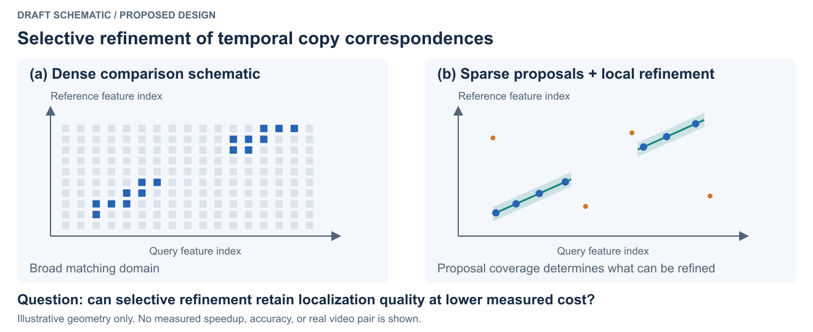
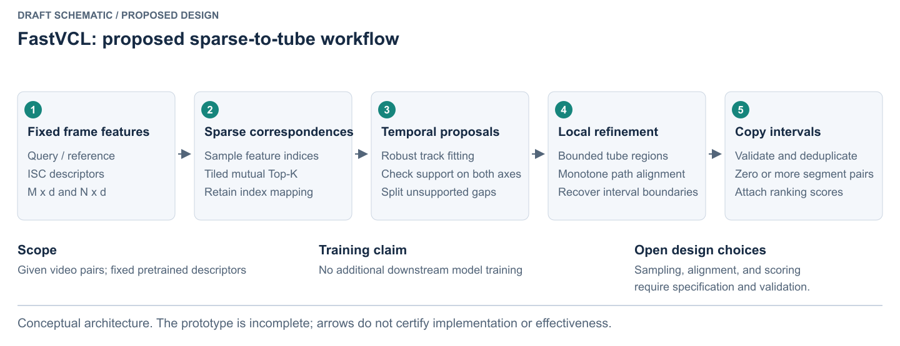
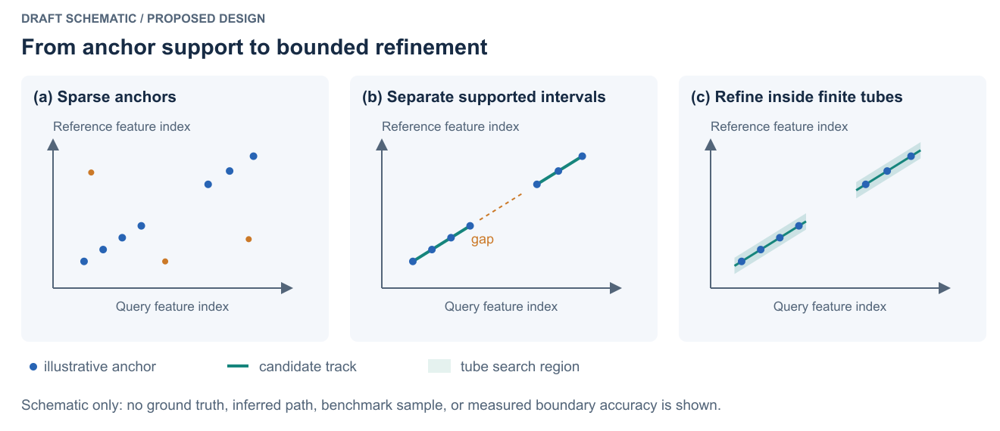
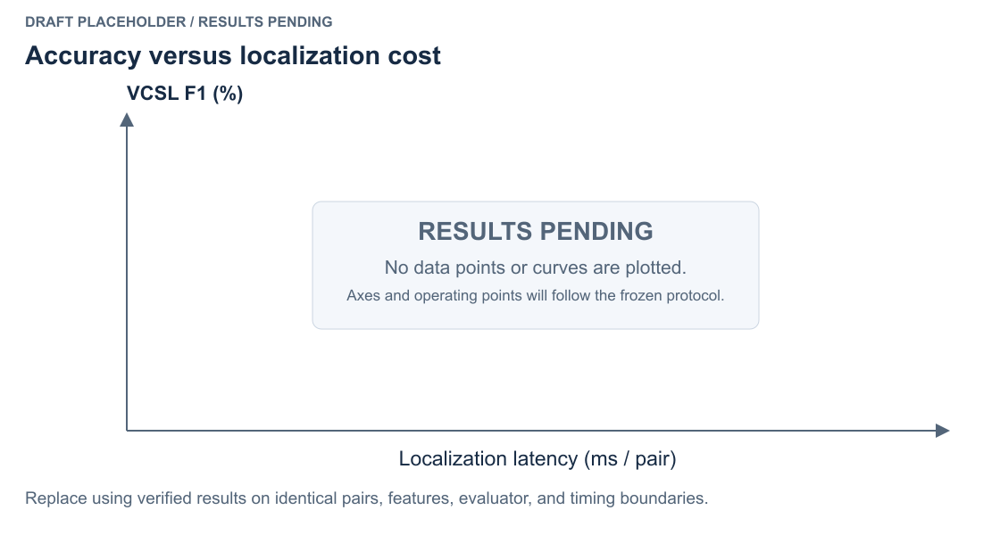

# FastVCL 初稿占位图

2026-10-17 按用户“先生成占位，后面调整”的要求制作。这些图表达拟议思路和版式，**不代表算法已经完成或实验已经验证**。

每张图交付：`.svg` 可编辑矢量源、`.pdf` 论文用矢量图、`.png` 快速预览。统一蓝色表示对应点、绿色表示轨迹/局部搜索域、橙色表示干扰点或间隙。

| 图 | PDF | SVG 编辑源 | PNG 预览 | 当前用途 |
|---|---|---|---|---|
| Fig. 1 | [PDF](fig_1_teaser.pdf) | [SVG](fig_1_teaser.svg) | [PNG](fig_1_teaser.png) | 稠密计算域与局部精化的概念对照 |
| Fig. 2 | [PDF](fig_2_framework.pdf) | [SVG](fig_2_framework.svg) | [PNG](fig_2_framework.png) | 拟议方法五阶段流程 |
| Fig. 3 | [PDF](fig_3_sparse_tracks.pdf) | [SVG](fig_3_sparse_tracks.svg) | [PNG](fig_3_sparse_tracks.png) | 锚点、间隙、有限 Tube 原理示意 |
| Fig. 4 | [PDF](fig_4_tradeoff.pdf) | [SVG](fig_4_tradeoff.svg) | [PNG](fig_4_tradeoff.png) | 精度—延迟空结果图，无数据点或曲线 |

## 重生成与修改

在论文根目录执行：

```bash
python3 scripts/generate_paper_placeholders.py
```

依赖 Python 3 标准库与 `rsvg-convert`。脚本不读取实验数据，也不生成随机指标；Fig1/3 的坐标为人工定义的说明性几何。建议修改脚本后重生成；如果直接编辑 SVG，应同时保存修改来源并重新导出，避免下次运行脚本覆盖手工修改。

导出单张修改后的 SVG：

```bash
rsvg-convert --format pdf --output figures/fig_2_framework.pdf figures/fig_2_framework.svg
rsvg-convert --format png --output figures/fig_2_framework.png figures/fig_2_framework.svg
```

## 初稿插入

优先使用 PDF，并按跨栏宽度放置。四张图当前都带有英文的示意/待测标记，适合内部初稿；最终稿需依照定型方法和实测结果逐张替换。

LaTeX 片段见 [placeholders.tex](placeholders.tex)。**四张 PDF 已实际编入 `main.tex`：Fig. 1 在引言，Fig. 2/3 在方法，Fig. 4 在实验；图注以 `main.tex` 中各 `figure*` 环境的版本为准。** `placeholders.tex` 仅保留为独立预览片段，不再作为正文入口。

建议英文图注（已写进 LaTeX 片段）：

1. **Conceptual comparison of matching domains.** Dense comparison examines a broad frame-pair domain, whereas the proposed sparse-to-tube design uses temporal proposals to restrict fine-resolution alignment. The geometry is illustrative and does not represent a measured baseline or experimental output.
2. **Proposed FastVCL workflow.** Fixed frame descriptors are processed into sparse correspondences, temporal proposals, locally refined alignments, and copy intervals. Sampling, alignment, and scoring choices remain subject to specification and validation; the diagram does not certify implementation completeness.
3. **Illustration of anchor-supported refinement.** Sparse correspondences suggest separated support intervals, which define finite tube regions for local alignment. All coordinates are schematic; this figure is not a qualitative benchmark result.
4. **Placeholder for the accuracy–latency comparison.** No measurements are shown. Operating points will be populated from verified runs using a frozen evaluation and timing protocol.

## 后续替换

- Fig1/2：方法定型后核对每个框、箭头和术语；不要为了匹配图而强行保留错误方法。
- Fig3：可以继续作为原理图；若改作真实案例，必须使用真实 pair、预测与 GT，记录样本选择规则和生成命令。有区间 GT 不等于有逐帧对应真值。
- Fig4：用真实结果绘图脚本替换；先明确横轴是 mean 还是 P50，以及同口径配置。无数据时保留空图。
- 占位图的源文件和真实实验图的源数据分开存档；真实图交付 run ID、输入 hash、脚本和输出文件。

## 预览








