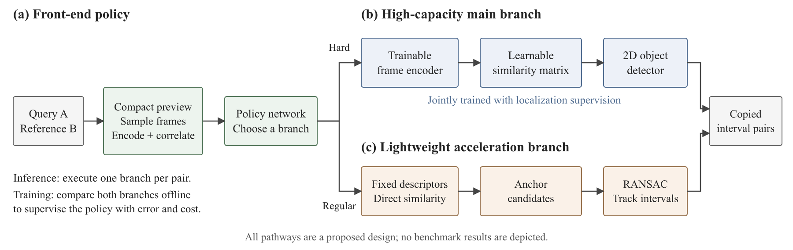

# Current framework figure

The active figure is the **policy-guided dual-pathway architecture** from the 2026-11-08
revision:

1. Query/reference input → compact preview → front-end policy.
2. Main branch: trainable frame encoder → learnable similarity matrix → 2D object detector.
3. Acceleration branch: fixed descriptors and direct similarity → anchors → RANSAC intervals.
4. One selected branch returns copied interval pairs at inference.

Training compares both branches offline to supervise the policy. This vector schematic is
a proposed design, not an experimental result.

## Regeneration

~~~bash
python3 scripts/generate_policy_framework.py
~~~

Dependencies: Python standard library and rsvg-convert. Outputs are framework.svg,
framework.pdf (included by sec/1_intro.tex), and framework.png.
The committed PDF builds on Overleaf without executing the generator.

## Historical assets

The fig_1 through fig_4 assets, placeholders.tex, and older generate_framework.py,
generate_round7_framework.py, and generate_paper_placeholders.py scripts belong to earlier
designs. They are retained as historical artifacts and excluded from both current entry points.
Old generators can overwrite framework assets with obsolete pipelines; use the current
[policy generator](../scripts/generate_policy_framework.py).
